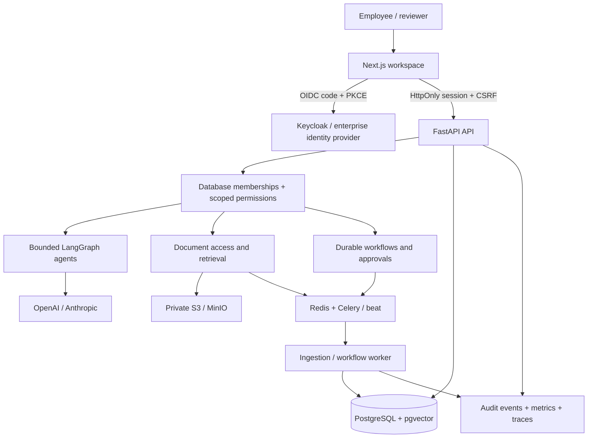

# EnterpriseFlow AI

**Secure Enterprise Agent & Workflow Automation Platform** — a departmental AI workspace for Finance, Human Resources, Legal, and Operations, using entirely fictional business data.

The application combines a Next.js workspace, FastAPI backend, permission-filtered document retrieval, bounded AI agents, durable workflows, and human approvals. Model calls require a configured provider. Without credentials, the application starts and reports that AI is unavailable; it does not fabricate results.

## Start locally

Prerequisites: Docker with Compose and at least 6 GB available memory. For host-side checks, Python 3.12+ and Node.js 22+.

```sh
cp .env.example .env
make dev
make seed
```

Open **http://localhost:3000**. OpenAPI is available at **http://localhost:8000/api/docs** and the development Keycloak console at **http://localhost:8080**. Compose applies migrations before starting the API. Allow Keycloak time to finish the first realm import. The local realm and all published credentials are strictly demonstration fixtures; ports bind only to loopback.

All ten accounts use the public local password **`LocalDemo2026!`**:

| Department | Employee | Manager |
|---|---|---|
| Finance | `finance.employee` | `finance.manager` |
| Human Resources | `hr.employee` | `hr.manager` |
| Legal | `legal.employee` | `legal.manager` |
| Operations | `operations.employee` | `operations.manager` |

`platform.admin` manages platform configuration without implicit confidential-document access. `audit.viewer` has explicitly assigned Finance audit visibility. Keycloak administrator: `admin` / the `KEYCLOAK_ADMIN_PASSWORD` in `.env`.

To use real AI, set `OPENAI_API_KEY` or `ANTHROPIC_API_KEY` and `DEFAULT_LLM_PROVIDER` in `.env`, then recreate backend and worker containers. Semantic embeddings require the configured OpenAI embedding provider; authorized lexical retrieval remains available without it. Deterministic provider doubles are limited to automated tests; there is no fake-provider login or interactive AI bypass. Real model output can still be incorrect and consequential workflows require review.

## Architecture



The backend is the authorization boundary. Platform administration and business-data access are separate. Restricted database credentials and row-level security provide additional protection for document tables in PostgreSQL. Workflows use deterministic steps and saved checkpoints around approval; no agent can run arbitrary SQL, shell commands, external HTTP tools, payments, or binding legal actions.

## Developer commands

```sh
make setup       # local venv + frontend dependencies; creates .env if absent
make dev         # build and start local Docker stack
make migrate     # apply database migrations in a separate privileged container
make seed        # idempotent fictional fixtures (local development only)
make test        # Python and frontend tests
make eval        # calculated evaluation results; no invented scores
make lint
make typecheck
make build
make test-e2e
make test-e2e-live # real OIDC and business journeys; requires make dev + make seed
make test-postgres # requires TEST_DATABASE_URL for a migrated disposable database
make check-infra # requires Terraform installed
make logs
make down        # preserves local data volumes
```

Host-side tests use isolated test configuration. `.env` defaults use Docker service names and are not a host-side API configuration; see [development setup](docs/development.md) for a host workflow.

The ordinary test suite skips PostgreSQL integration tests when `TEST_DATABASE_URL` is absent. `make test-postgres` requires that variable explicitly. Fixture-backed browser tests and real-service browser tests are separate commands; neither measures live model quality without provider credentials.

## Repository

| Path | Responsibility |
|---|---|
| `apps/api` | Auth, schema, APIs, AI providers, retrieval, workers, workflow engine, seed/evaluation |
| `apps/web` | Workspace, business workflows, visual editor, charts, typed client |
| `tests` | Integration, authorization, security and journey coverage |
| `infrastructure/docker` | Containers, local identity fixtures, restricted DB role |
| `infrastructure/terraform` | AWS ECS, private data services, TLS, IAM, secrets and monitoring |
| `.github/workflows` | CI checks and protected-environment release workflow |
| `demo-data` | Synthetic source documents and data manifest |
| `docs` | Architecture, security, API, operations, evaluation and demonstration guides |

## Verification and deployment

[IMPLEMENTATION_STATUS.md](IMPLEMENTATION_STATUS.md) records the actual checks performed and unresolved limitations. Infrastructure code and CI configuration are not evidence of a deployed or independently audited system. AWS deployment and external model calls require credentials and environment validation; no cloud resources are created by the local setup.

See [deployment and rollback](docs/deployment.md), [security boundaries](docs/security.md), [API guide](docs/api.md), [evaluation methodology](docs/evaluation.md), [portfolio demonstration](docs/portfolio-demo.md), and [technical interview walkthrough](docs/interview-walkthrough.md).
